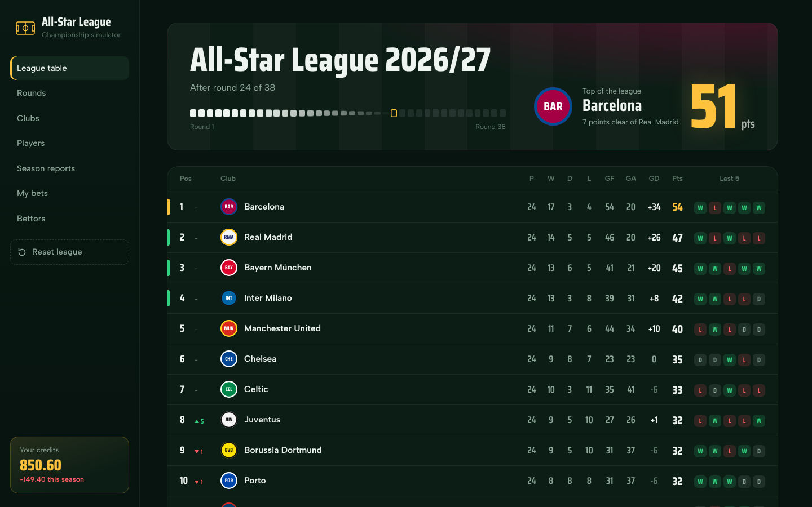
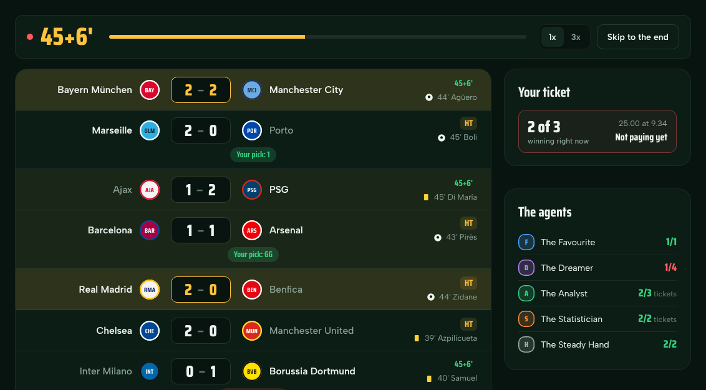
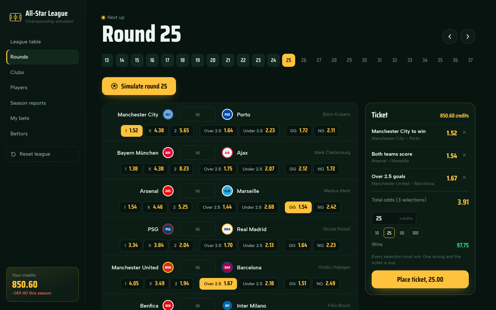
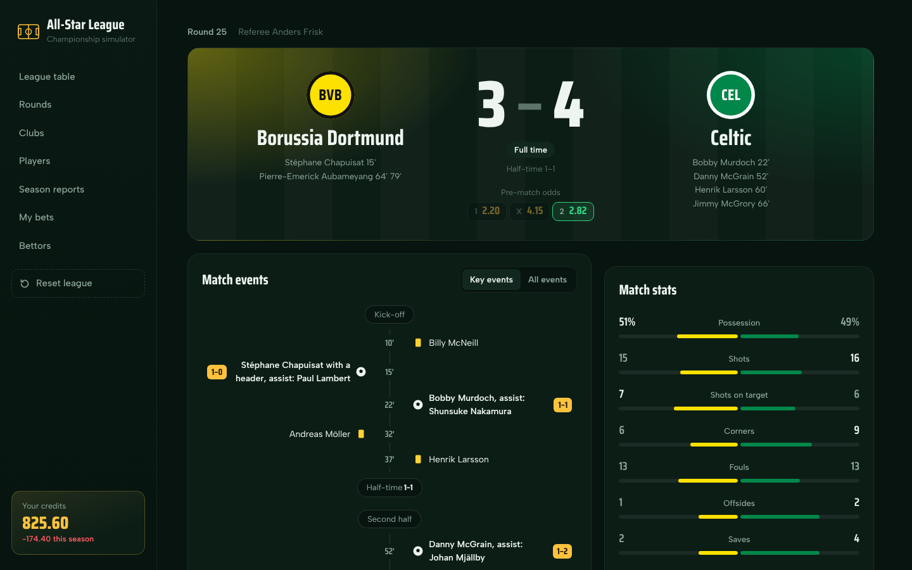
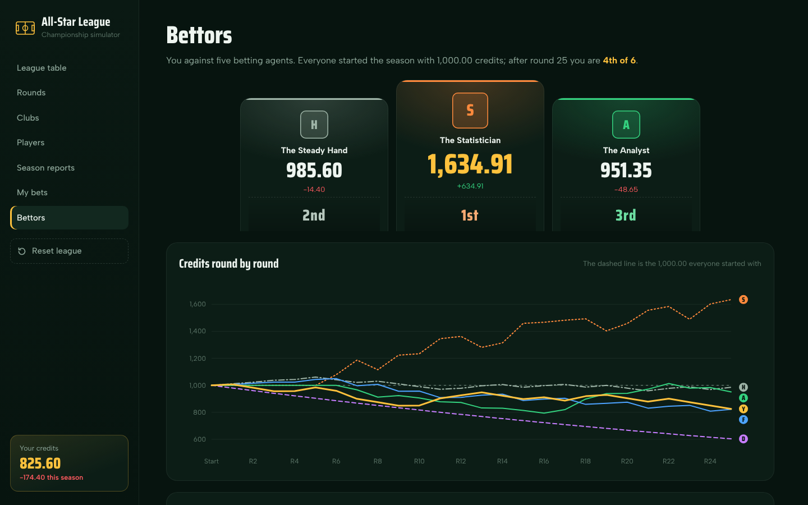
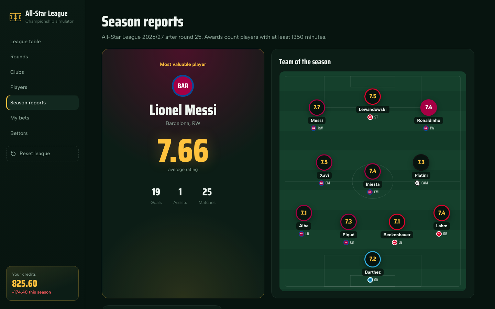
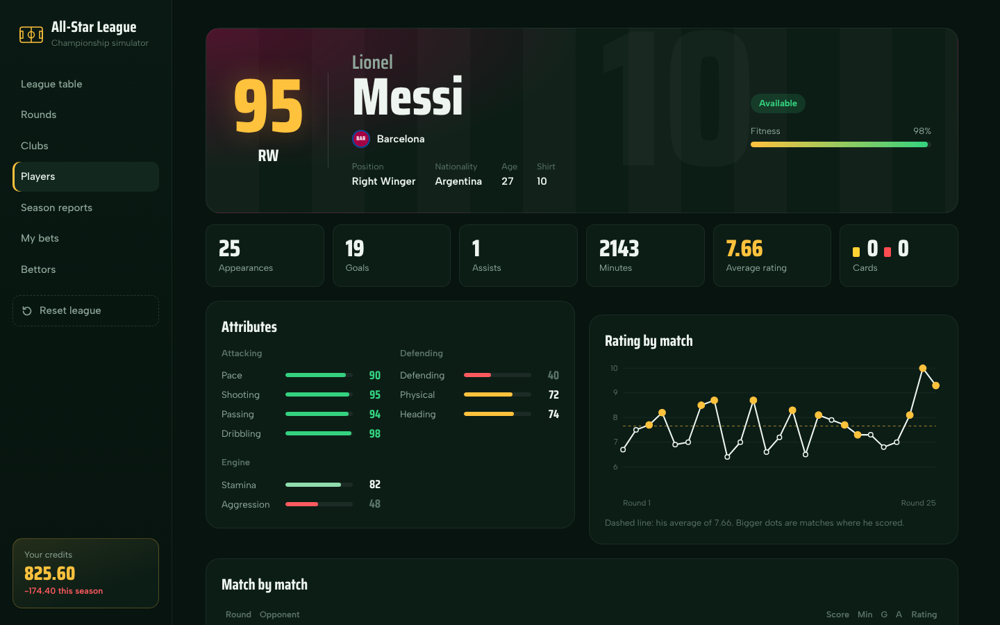
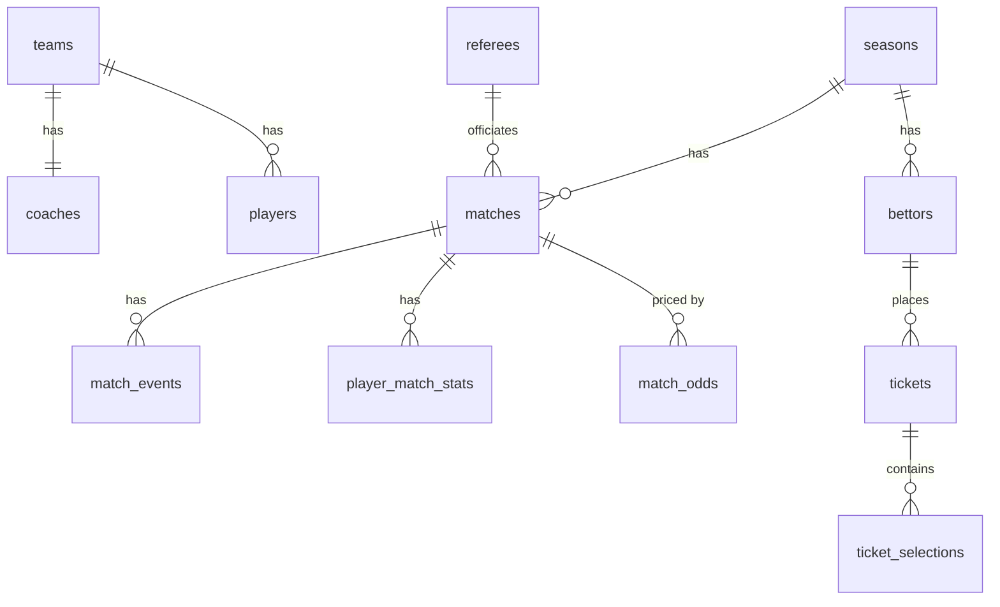

# Football Championship Simulator

A football season simulator with a web app on top: **20 legendary clubs, 500 all-time great players, 38 rounds**. Watch every round play out live, open any match minute by minute, bet on the results and try to beat five AI betting agents.

The backend is written in **Java with Spring Boot and PostgreSQL**, the frontend in **React**. The same season can also be played from a console menu.



## Features

- **Live rounds**: all ten matches play at once on a shared clock, with goals, cards and half-time.
- **Match reports**: key events or full commentary, team stats and player ratings.
- **Betting**: odds for 1X2, over/under 2.5 and both teams to score, combined into accumulator tickets.
- **AI bettors**: five agents with their own strategies bet against you, on a leaderboard with a balance chart.
- **Clubs, players and season awards**: squads, form, rating charts, top scorers, team of the season and MVP.
- **Saved and resumable**: everything lives in PostgreSQL. Continue where you stopped or reset the league from the app.

| | |
|---|---|
|  |  |
| **Live round**: scores, events and your ticket update as the matches play | **Betting**: pick odds, build a ticket, choose a stake |
|  |  |
| **Match report**: timeline of events and team statistics | **Bettors**: you against the agents, round by round |
|  |  |
| **Season reports**: MVP and team of the season | **Player profile**: attributes and rating in every match |

## How it works

**Match engine.** A match is a chain of short passages of play (an attack, a cross, a foul, a shot), modelled as a **state machine** that follows this [decision tree](docs/match-simulation-tree-decision.md). Every decision is a weighted random draw, and better players get bigger slices: Messi scores more often than an average striker, but Steaua București can still beat Real Madrid. Over 30 simulated seasons the engine averages 2.9 goals and 26 shots per match, close to real top-flight football.

**Odds.** Before a round, every match is simulated **1,000 times** (Monte Carlo, in parallel). The share of home wins, draws, over 2.5 goals and so on becomes a probability, and the bookmaker keeps a margin of 5%, a bit more on big favourites. A calibration check confirms the odds are honest: matches given a 55% chance end that way about 55% of the time.

**Betting agents.** Strategies written in code, each with its own personality:

| Agent | Strategy |
|---|---|
| The Favourite | One single on the biggest favourite of the round, 5% of the balance |
| The Dreamer | A four-match ticket of upsets at big odds, 2% of the balance |
| The Analyst | Bets only where its own model says the odds are too generous; stakes by the Kelly criterion |
| The Statistician | Only goals markets, from the teams' scoring averages and a Poisson model |
| The Steady Hand | A double on the two safest selections of the round, always 20 credits |

## Built with

- **Backend**: Java 21, Spring Boot 3, PostgreSQL with plain JDBC and hand-written SQL, Maven
- **Frontend**: React 18, React Router, Vite, hand-made SVG charts
- **Tests**: JUnit 5 and MockMvc, 141 tests that run without a database

Design highlights:

- **OOP**: `Person` → `Player`, `Coach`, `Referee`; encapsulated player state; abstract match states and events
- **Design patterns**: State (match situations), Strategy (position ratings, betting agents), DAO
- **Dependency inversion**: the league and betting logic only know interfaces (`SeasonStore`, `OddsStore`, `BettingStore`), so the tests use in-memory stores
- **REST API**: thin Spring controllers over plain Java services, records as DTOs
- **SQL**: transactions (a ticket is paid completely or not at all), a view for the table, CTEs, window functions and aggregate filters for the reports

## Database



## Getting started

You need Java 21+, Node.js 18+ and PostgreSQL.

1. Create a PostgreSQL database `football_cs` with a user `fcs_user` that owns it.
2. Run the scripts in `src/main/resources/db`, in this order: `schema.sql`, `seed.sql`, `season_schema.sql`, `betting_schema.sql`, `team_balance.sql`.
3. Copy `src/main/resources/db.properties.example` to `db.properties` and fill in your password.
4. Start the backend: run `org.example.web.WebApplication` (port 8080).
5. Start the frontend:
   ```
   cd frontend
   npm install
   npm run dev
   ```
6. Open **http://localhost:5173**

Prefer the terminal? Run `org.example.Main` for the console version.

To run the tests, right-click `src/test/java` → **Run 'All Tests'** in IntelliJ, or use `mvn test`.

## About the data

The league is fictional, with legends from different eras, each at the club where he was most iconic. Player attributes are inspired by FIFA / EA FC ratings; they are approximations, not official EA Sports data.
