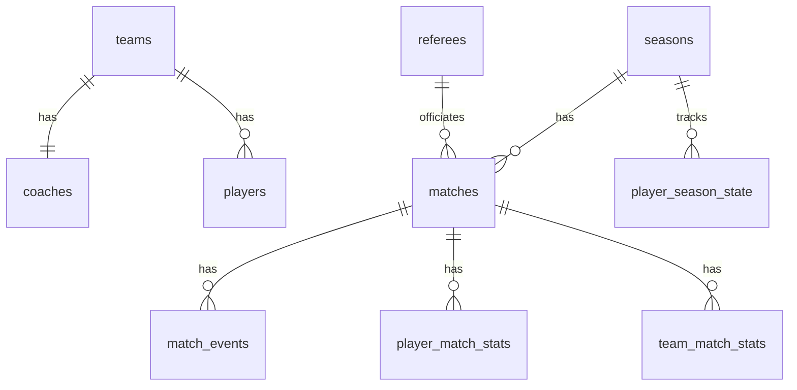

# Football Championship Simulator

A Java console game that simulates a full football season: **20 legendary clubs, 500 all-time great players, 38 rounds**. You play the season round by round, follow the league table, open any match to see what happened minute by minute, and check every player's statistics. Everything is saved in a PostgreSQL database, so you can close the game and continue later.

Every match is played by a probabilistic engine: better players have better chances, but nothing is ever certain. Messi will score more often than an average striker, and Steaua București can still beat Real Madrid.

## What you can do

```
=== All-Star League 2026/27 | next: round 2 of 38 ===
1. Simulate next round
2. Show the league table
3. Find a match
4. Player statistics
5. Top scorers
6. Team results and fixtures
7. Season reports and awards
8. Start a new season
0. Exit
```

- **Simulate the next round** and see all ten results at once.
- **League table** with points, goal difference, head-to-head and recent form.
- **Find a match** by typing the two teams (`steaua`, `barcelona`) and read the key events or the full commentary, the team statistics and the player ratings.
- **Player statistics**: goals, assists, cards, minutes and rating for the season and for every match.
- **Season reports**: top scorers and assists, discipline, best goalkeepers, team of the season, MVP and season records.
- **Continue where you stopped**: on startup the game loads the last saved season.

## A match report

```
=== Steaua București 3-6 Barcelona (round 1, KEY events, referee Pierluigi Collina) ===
1'      KICK-OFF
13'     GOAL! Dani Alves (Barcelona), assist: Lionel Messi [0-1]
16'     GOAL! Luis Suárez (Barcelona), assist: Dani Alves [0-2]
31'     GOAL! Lionel Messi (Barcelona) with a header, assist: Xavi [0-3]
40'     GOAL! Lionel Messi (Barcelona), assist: Jordi Alba [0-4]
43'     GOAL! Nicolae Dică (Steaua București), assist: Lucian Bălan [1-4]
45+6'   HALF-TIME [1-4]
47'     GOAL! Victor Pițurcă (Steaua București), assist: Adrian Ilie [2-4]
53'     GOAL! Jordi Alba (Barcelona) with a header, assist: Xavi [2-5]
60'     SUBSTITUTION (Steaua București): Adrian Bumbescu on, Daniel Prodan off (card risk)
70'     GOAL! Lionel Messi (Barcelona), assist: Andrés Iniesta [2-6]
90+2'   GOAL! Gheorghe Hagi (Steaua București) from a free kick [3-6]
90+8'   FULL-TIME [3-6]

                    STE      BAR
Shots                 7       14
On target             4        8
Possession %         47       53
```

## How a match is simulated

A match is a chain of short passages of play: an attack, a cross, a foul, a shot. The engine is a **state machine** that moves from one situation to the next, following this [decision tree](docs/match-simulation-tree-decision.md).

Every decision (does the attack break down? is the shot a goal?) is made with a **roulette wheel**. Each outcome gets a slice, and the players involved make the slices bigger or smaller: a great shooter facing an average keeper gets a bigger "goal" slice. Then a random number picks the outcome.

On top of that the engine handles stoppage time, fatigue, yellow and red cards, suspensions, injuries and up to five substitutions chosen by the coach.

The weights were tuned by simulating thousands of matches. Over 30 seasons the engine averages 2.9 goals, 26 shots and 4 yellow cards per match, and the champion finishes on about 78 points, close to real top-flight football.

## Built with

- **Java 21+**, **Maven**, **PostgreSQL** with plain **JDBC** and hand-written SQL
- **JUnit 5**: 73 tests for the engine, the players, the schedule, the league table and the seasons

Design highlights:

- **OOP**: `Person` → `Player`, `Coach`, `Referee`; encapsulated player state; abstract match states and events
- **State pattern**: one class per situation of the decision tree (`AttackState`, `CrossState`, `ShootState`...)
- **Strategy pattern**: a different OVR formula for each position
- **DAO pattern** and **transactions**: each match is saved completely or not at all
- **Dependency inversion**: the league logic only knows a `SeasonStore` interface, so the tests use an in-memory store instead of the database
- **SQL**: a view for the league table; CTEs, window functions and aggregate filters for the season reports

## Database



The league table (`v_standings`) is a view calculated from the played matches.

## Getting started

1. Create a PostgreSQL database `football_cs` with a user `fcs_user` that owns it.
2. Run the scripts in `src/main/resources/db`, in this order: `schema.sql`, `seed.sql`, `season_schema.sql`.
3. Copy `src/main/resources/db.properties.example` to `db.properties` and fill in your password.
4. Run `org.example.Main`.

To run the tests, right-click `src/test/java` → **Run 'All Tests'** in IntelliJ, or use `mvn test`.

## About the data

The league is fictional, with legends from different eras, each at the club where he was most iconic. Player attributes are inspired by FIFA / EA FC ratings; they are approximations, not official EA Sports data.
