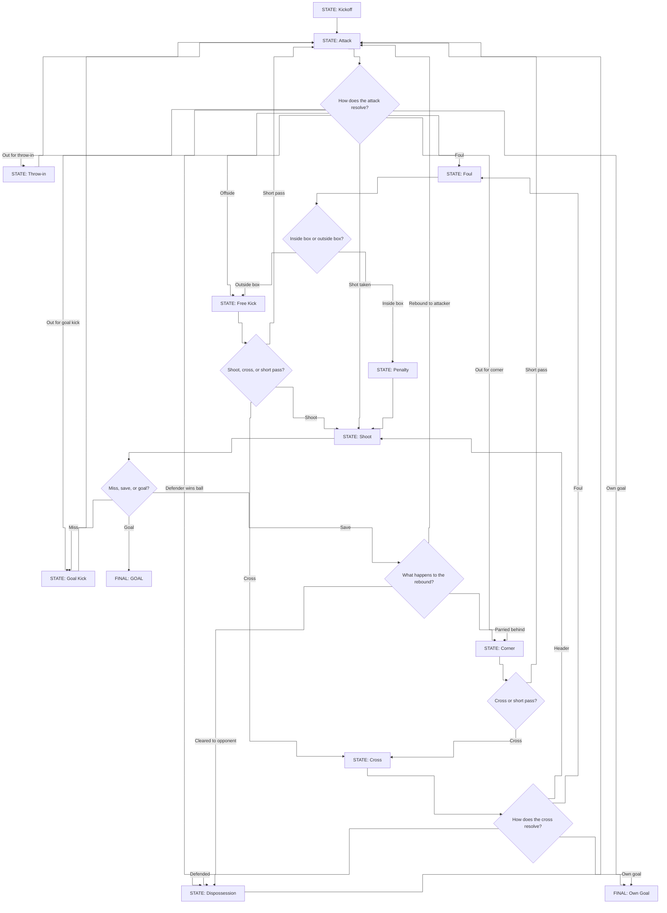

# Match Simulation - Decision Tree

This document describes the state machine used to simulate a football match, phase by phase.

## Core concept

A match is not simulated minute by minute. It is a chain of **phases**: short passages of play, each one a single walk through the diagram below. A phase starts from a state (a kickoff, a corner, a throw-in), follows the arrows through a few decisions, and stops at a state that becomes the starting point of the next phase. A missed shot, for example, ends the phase in `Goal Kick`, and the next phase starts from that goal kick for the other team.

Each phase adds a few seconds to the match clock, more for a free kick being set up or a goal celebration. When the clock passes 90 minutes plus stoppage time, the match ends.

Every decision along the way (does the attack break down, is the shot a goal) is made by spinning a **roulette wheel**. The better the players involved, the bigger the slice of the wheel that favours them, but every result keeps a chance. Stronger teams win more often; they never win for sure.

## Phase state machine



## Reading the diagram

- **STATE** boxes are what is happening on the pitch. **Diamonds** are decisions: every arrow leaving a diamond is one possible result.
- Most results lead straight into another state that starts the next phase. When the result means the ball changed hands (defender wins the ball, a missed shot, a defended cross), the next phase belongs to the other team.
- Only `GOAL` and `Own Goal` reset the match to a fresh kickoff, for the team that conceded.
- A cross can end in a **header**, which goes to `Shoot` like any other chance. That is how goals from crosses and corners happen.

## How a decision is made

Every diamond is resolved the same way, in four steps.

**1. Base weights.** Each arrow gets a starting weight: how often that result happens between two average, equal sides. For "Miss, save, or goal?" that might be Goal 15, Save 35, Miss 50.

**2. Attributes.** The players involved change the weights. Results that are good for the attacking team are multiplied by a **skill factor**, and results that are bad for them are divided by it:

```
skill factor = (attacker's attribute / defender's attribute) ^ 2
```

Two equal players give a factor of 1, so nothing changes. A clearly better attacker gives a factor above 1: his good slices grow and his bad ones shrink. Squaring the ratio makes a real gap between two players count, without ever turning it into a certainty.

When a whole team attacks a whole team, the ratings are much closer (every side in this league is between 85 and 91 OVR), so that duel uses a stronger exponent: `(attack rating / defence rating) ^ 9`. A side rated 90 against one rated 86 gets a factor of about 1.5.

**3. Modifiers.** A few small factors tilt the wheel a little more:

| Modifier | Effect |
| --- | --- |
| Team strength | Attack rating (average OVR of the midfielders and forwards on the pitch) against defence rating (average OVR of the defenders and midfielders) |
| Home advantage | Good results for the home team x 1.05 |
| Fatigue | Attributes drop slowly during the match; players with high STAMINA drop less |
| Red card | A team with fewer players gets x 0.90 per missing player |

**4. Spin.** All weights are divided by their total, so the slices fill the interval from 0 to 1. The engine draws one random number between 0 and 1 and follows the arrow whose slice it lands in.

### Example: Miss, save, or goal?

Messi (SHOOTING 92) shoots at Buffon (REFLEXES 92). An average striker (SHOOTING 75) shoots at the same keeper.

| Result | Messi | Average striker |
| --- | --- | --- |
| Goal | 0.00 - 0.16 | 0.00 - 0.08 |
| Save | 0.16 - 0.51 | 0.08 - 0.46 |
| Miss | 0.51 - 1.00 | 0.46 - 1.00 |

The engine draws **0.12**. It lands in Messi's goal slice, so Messi scores; for the average striker the same number is a save. A better shooter does not decide the result, he makes the goal slice bigger.

## Which attributes decide each diamond

**Shoot, cross, or short pass?** (free kick)

| Arrow | Grows with |
| --- | --- |
| Shoot | SHOOTING of the best free-kick taker on the pitch |
| Cross | PASSING of the best crosser and the average HEADING of the players in the box |
| Short pass | PASSING of the midfielders |

**Cross or short pass?** (corner)

| Arrow | Grows with |
| --- | --- |
| Cross | HEADING of the three best headers (centre-backs come up for corners) |
| Short pass | PASSING of the midfielders |

**How does the attack resolve?**

| Arrow | Grows with |
| --- | --- |
| Shot taken | Attack rating: average OVR of the attacking midfielders and forwards |
| Defender wins ball | Defence rating: average OVR of the defending defenders and midfielders |
| Foul | AGGRESSION of the defenders and DRIBBLING of the attacker (dribblers get fouled) |
| Offside | Fixed weight; the forward caught offside is picked by PACE |
| Out for corner | Attacking pressure: a beaten defender clears behind |
| Out for throw-in, out for goal kick | Fixed weights |
| Own goal | Very small, fixed |

**How does the cross resolve?**

| Arrow | Grows with |
| --- | --- |
| Header | Crosser's PASSING and the target's HEADING (and PHYSICAL) |
| Defended | Defenders' HEADING and PHYSICAL, and the keeper's HANDLING (he comes out and claims it) |
| Foul | Defenders' AGGRESSION and the attacker's PHYSICAL |
| Own goal | Very small, fixed |

**Inside box or outside box?** This depends on where the foul came from: a foul during a cross is often inside the box (around 40%), a foul during a normal attack rarely is (around 10%). A defender with high AGGRESSION raises the chance a little. Every foul is also followed by a **card check** (no card, yellow or red), based on the referee's strictness and the fouler's AGGRESSION.

**Miss, save, or goal?**

| Arrow | Grows with |
| --- | --- |
| Goal | Shooter's SHOOTING (HEADING for a header) x chance quality |
| Save | Keeper's REFLEXES |
| Miss | Pressure from the nearest defender's DEFENDING; smaller for a good shooter |

Chance quality depends on how the shot came: penalty 1.6, normal attack 1.0, header 0.9, direct free kick 0.8.

**What happens to the rebound?**

| Arrow | Grows with |
| --- | --- |
| Rebound to attacker | Low HANDLING of the keeper and PACE of the attackers (first to the ball) |
| Parried behind | Keeper's REFLEXES without the HANDLING to hold the ball |
| Cleared to opponent | Keeper's HANDLING |

## Who takes the action

The player who shoots, crosses or heads is also picked with a roulette wheel. Every player on the pitch gets a weight equal to his **role weight x the attribute that matters**:

| Action | Role weights (GK / DEF / MID / FWD) | x attribute |
| --- | --- | --- |
| Shot | 0 / 1 / 3 / 5 | SHOOTING |
| Assist | 0 / 1 / 4 / 3 | PASSING ^ 3 (playmakers get most assists) |
| Cross | 0 / 2 / 3 / 3 | PASSING |
| Header from a cross | 0 / 2 / 1 / 4 | HEADING |
| Free kick and penalty | Always the best SHOOTING on the pitch | - |

This is why strikers score most goals, yet a centre-back with a great header still scores from corners now and then.

## Where each attribute is used

| Attribute | Used in |
| --- | --- |
| PACE | Offside, rebounds, team ratings (through OVR) |
| SHOOTING | Choosing the shooter, free kicks, goals |
| PASSING | Choosing the assist, crosses, short corners and free kicks |
| DRIBBLING | Fouls suffered, team ratings (through OVR) |
| DEFENDING | Pressure on shots, choosing the tackler, team ratings (through OVR) |
| PHYSICAL | Duels on crosses, team ratings (through OVR) |
| HEADING | Corners, crosses, headed goals |
| REFLEXES | Saves |
| HANDLING | Rebounds, claiming crosses |
| STAMINA | Fatigue: all attributes drop slowly late in the match |
| AGGRESSION | Fouls, penalties, cards |
